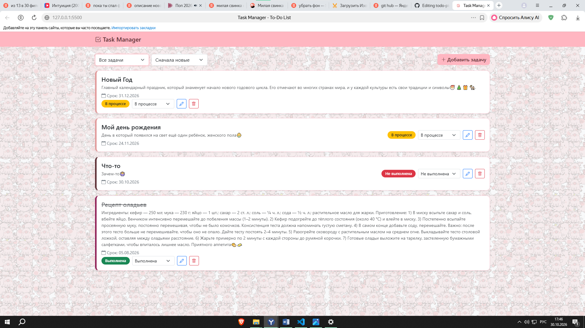
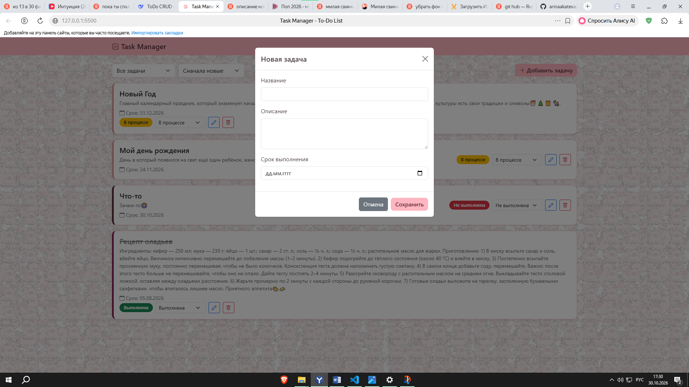
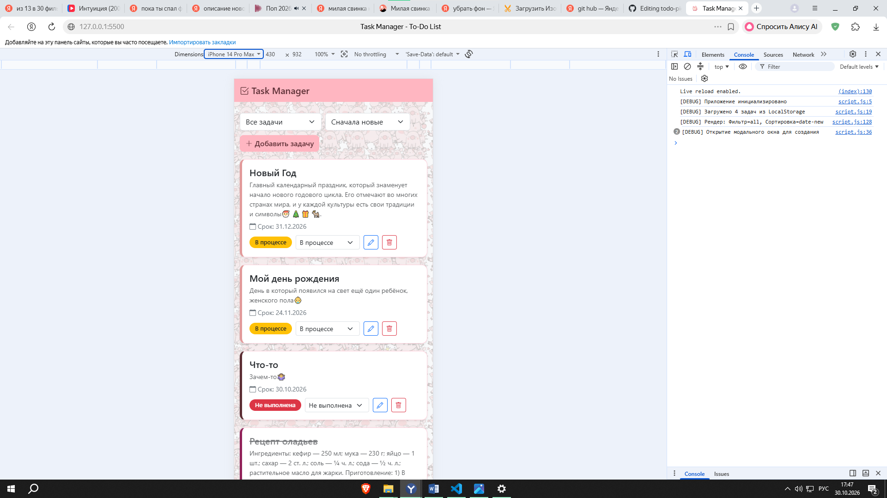

🐷 Task Manager - To-Do List
🔗 **[Посмотреть сайт вживую](https://arinaakateva2-art.github.io/todo-pig-app/)**
Веб-приложение для управления задачами (To-Do List), выполненное в уютном розовом дизайне с милыми свинками. Проект создан для удобного отслеживания дел и демонстрации навыков работы с чистым JavaScript.

✨ Функционал

Приложение реализует полный цикл **CRUD** (Create, Read, Update, Delete) и другие полезные функции:

**Создание (Create):** Добавление задач с указанием названия, описания и срока выполнения.
**Чтение (Read):** Отображение всех задач в виде адаптивных карточек.
**Редактирование (Update):** Изменение данных задачи через модальное окно. Также реализована быстрая смена статуса прямо в карточке.
**Удаление (Delete):** Удаление задач с подтверждением действия.
**Фильтрация:** Сортировка задач по статусу (Все, Выполненные, Невыполненные, В процессе).
**Сортировка:** По дате выполнения (сначала новые/старые) и по алфавиту.
**Сохранение данных:** Все задачи сохраняются в LocalStorage браузера, поэтому они не пропадают при перезагрузке страницы.
**Логирование:** Все действия пользователя и возможные ошибки выводятся в консоль разработчика (F12).
**Адаптивность:** Интерфейс корректно отображается на компьютерах, планшетах и смартфонах.

🛠 Технологии

**HTML5** — структура страницы.
**CSS3 + Bootstrap 5** — стилизация и адаптивная сетка.
**JavaScript (Vanilla)** — вся логика приложения (без использования фреймворков).
**LocalStorage API** — хранение данных на стороне клиента.

📸 Скриншоты проекта

**Главный экран со списком задач:**

**Модальное окно добавления/редактирования:**

**Мобильная версия:**

🚀 Как запустить проект

Проект не требует установки дополнительных библиотек или сборщиков. 

1. Скачайте все файлы из этого репозитория.
2. Откройте файл `index.html` в любом современном браузере.
3. Наслаждайтесь порядком в делах! 🐷💖
